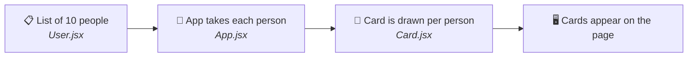
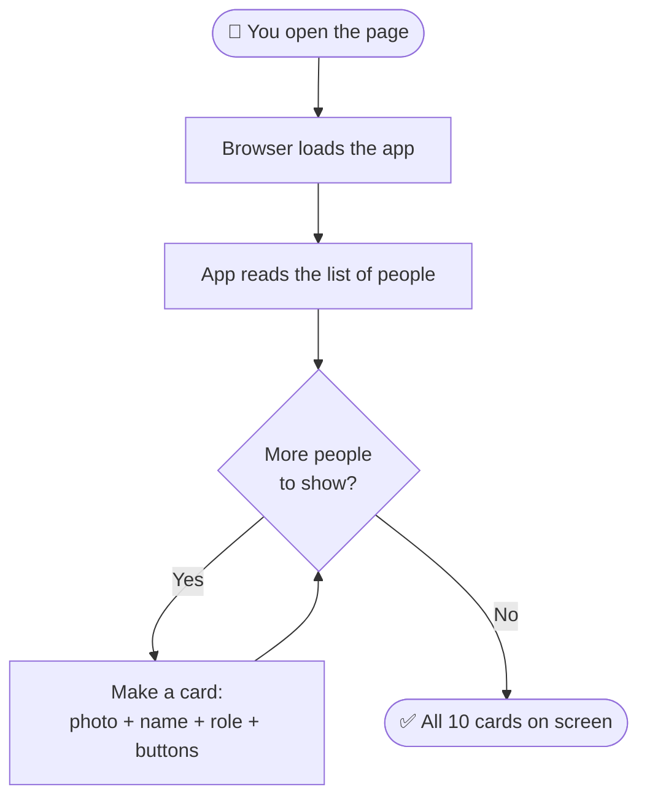
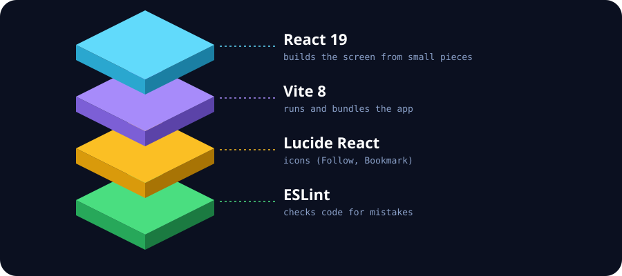

<div align="center">


</div>

## What is this?

A web page that shows **10 people as cards**. Each card has a photo, a name, a job title, a **Follow** button and a **bookmark** icon.

That's all it does today. It is a practice project for learning React components and props.

## How it works (in plain words)



**What you see vs. what happens:**



## Tech stack



| Part | Version (from `package.json`) | Used for |
|---|---|---|
| React / React DOM | `^19.3.1` | Building the UI from components |
| Vite | `^8.3.6` | Dev server and production build |
| `@vitejs/plugin-react` | `^6.1.2` | Lets Vite understand React (JSX) |
| lucide-react | `^1.72.0` | `UserRoundPlus` and `Bookmark` icons |
| ESLint | `^10.14.0` | Code quality checks |
| Plain CSS | – | All styling (`src/index.css`) |

## Project structure

```text
├── index.html              # Page shell with <div id="root">
├── src/
│   ├── main.jsx            # Starts React
│   ├── App.jsx             # Loops over people, renders a Card for each
│   ├── index.css           # Styles for the page and cards
│   └── components/
│       ├── Card.jsx        # One profile card
│       └── User.jsx        # The data: 10 people (id, image, name, role)
├── public/                 # Favicon and icons
├── vite.config.js          # Vite + React plugin
└── eslint.config.js        # Lint rules
```

## Run it

Requires [Node.js](https://nodejs.org) (current LTS or newer).

```bash
npm install      # one-time setup
npm run dev      # start locally, open the URL shown
npm run build    # make a production build
npm run lint     # check code
```

## Good to know

- **Follow and bookmark buttons are visual only.** They don't do anything when clicked yet.
- **Photos load from Unsplash**, so an internet connection is needed to see them.
- `src/App.css` and a few files in `src/assets/` come from the Vite template and aren't used by the app.

## Ideas for next steps

- Make Follow / Bookmark work (React `useState`)
- Add a search box or role filter
- Save follow state in the browser

---

<sub>Banner and stack visuals are animated SVGs in `assets/` with fonts (Space Grotesk, JetBrains Mono) embedded. Animation shows on GitHub; some viewers show a still image.</sub>
